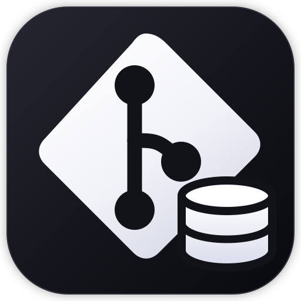

# GitArchive

<p align="center">
  
</p>

**GitArchive** is a local-first desktop application for keeping persistent Git mirrors of remote repositories. The desktop interface is built with PySide6 and follows the visual language of Windows 11 / WinUI 3; the archive engine is written in Rust.

> Current status: early MVP foundation. GitArchive archives Git repository data from GitHub, GitLab, Codeberg, Bitbucket, Gitea, Forgejo, SourceHut, and custom/self-hosted Git servers through standard HTTPS or SSH clone URLs.

## Features

- Add Git repository clone URLs using HTTPS or SSH.
- Supports common hosting services and arbitrary custom Git server hostnames; no provider-specific REST API is required for Git mirroring.
- Handles nested namespaces such as GitLab groups and subgroups.
- Create bare Git mirrors containing branches, tags, and Git objects.
- Refresh repositories every **10 minutes** by default; the interval is configurable.
- Preserve old ref tips before each fetch under `refs/gitarchive/snapshots/`, retaining history after force-pushes.
- Restore a normal working copy from a local mirror, including archived historical refs.
- Never prune remote refs or delete a local mirror when its source becomes unavailable.
- Run several repository syncs concurrently (three by default) and stream Git transfer progress into the activity log.
- Show local archive sizes and apply a global **soft** storage limit.
- Keep a persistent local activity log and prevent multiple app instances from writing to the same mirrors.
- Minimize to the Windows notification area (system tray).
- Follow Windows light/dark preference and system accent color; request Mica on supported Windows 11 builds.
- Browse up to 250 commits from the local archive, inspect commit metadata and changed-file summaries, and export any selected commit as a ZIP snapshot.
- Open a repository context menu with history, sync, open archive, restore, and remove-from-list actions. Removing a list entry never deletes the archive.
- Optional current-user Windows startup and minimize-to-tray behavior.
- Optional HTTP, HTTPS, SOCKS4 and SOCKS5 proxy settings for HTTPS Git remotes. SOCKS proxies use remote DNS resolution; proxy credentials are not stored. SSH remotes use the configured SSH transport and do not use Git's HTTP proxy setting.

## Supported Git servers

The app accepts standard HTTPS and SSH clone URLs from:

- GitHub
- GitLab, including nested groups and subgroups
- Codeberg
- Bitbucket
- Gitea and Forgejo
- SourceHut
- Custom and self-hosted servers, such as a private GitLab, Gitea, Forgejo, or another server implementing Git's HTTPS/SSH transport

For a custom server, paste its repository's **Clone** URL. Examples:

```text
https://git.example.net/team/project.git
ssh://git@git.example.net:2222/team/project.git
git@git.example.net:team/project.git
```

GitArchive does not need to know the brand of a custom server: the Git client handles the Git transport. Hosting-provider names are used for display and organization only. HTTPS and SSH are supported; plain HTTP, local filesystem paths, URL-embedded passwords/tokens, query strings, and unsupported remote-helper transports are rejected. Configure private-repository credentials through Git Credential Manager or SSH keys. GitArchive does not ask for or store personal access tokens.

The mirror engine archives Git repository data, not each hosting site's complete web platform. Provider-specific Releases attachments, wiki pages, Issues, Pull Requests/Merge Requests, CI artifacts, Git LFS object payloads, and the separate repositories referenced by submodules are not downloaded in this version. Git LFS pointers remain in Git history until dedicated LFS archiving is added; submodule repositories should be added to GitArchive separately.

## Repository history and context menu

Double-click a repository row or right-click it to open the WinUI-inspired context menu. The history viewer reads commit objects directly from the local bare mirror, including retained snapshots. It shows up to 250 commits and their metadata / changed-file summaries. Select a commit and choose **Download selected commit (.zip)** to export that exact tree. This exports the repository files at that commit; it is not a second copy of the entire Git history.

The context menu also provides sync, open archive folder, restore working copy, and remove from list. **Remove from list does not delete the archive directory.**

## Proxy and startup settings

Settings support HTTP, HTTPS, SOCKS4 and SOCKS5 proxies for HTTPS Git remotes. SOCKS4 uses `socks4a://` and SOCKS5 uses `socks5h://` so DNS resolution is delegated to the proxy. The proxy address and port are stored in the local app config; proxy authentication fields are not implemented. Git's `http.proxy` setting does not proxy SSH clone URLs.

The Windows startup option writes a per-user Run entry (no administrator rights). Background startup starts directly in the tray. The close-to-tray option keeps the app running when the window is closed; use **Exit** in the tray menu to stop it.

## Build a Windows portable app and installer

Install Python 3.11+, Rust stable, Git for Windows, and (for the installer) Inno Setup 6 or 7. Then run:

```bat
build_windows.bat
```

The script generates the Windows multi-resolution icon from the source SVG, builds the Rust engine with one Cargo job, packages the PySide6 app as a one-folder portable application with PyInstaller, places the Rust engine beside it, and invokes Inno Setup when its compiler is installed. Outputs:

- Portable application: `dist\\GitArchive\\GitArchive.exe` plus its adjacent runtime files.
- Installer: `dist-installer\\GitArchive-Setup.exe` (when Inno Setup is installed).

Git for Windows remains a runtime dependency and is not bundled. The installer is per-user and does not require administrator privileges. This build script has not yet been validated on a clean Windows machine; the first packaged build must be smoke-tested before distribution.

## LAN and ZeroTier peer exchange

Peer-to-peer archive exchange is **not implemented yet**. Its security and protocol requirements are documented in [docs/NETWORK_SYNC_DESIGN.md](docs/NETWORK_SYNC_DESIGN.md). The design requires opt-in sharing, mutual TLS 1.3, pinned peer identities, explicit import approval, staging, and `git fsck --full --strict` before an archive is promoted. It will not trust a peer solely because it is on the same LAN or ZeroTier network.

## Run on Windows

1. Install **Python 3.11+**, **Rust stable** (rustup), and **Git for Windows**.
2. Clone this repository.
3. Double-click `start.bat`.

The launcher creates `.venv`, installs `requirements.txt`, builds the Rust engine in release mode, and starts the app. It does not install system-wide packages or change Windows settings. The standard Rust MSVC toolchain may also require **Visual Studio Build Tools** with the C++ build tools workload; install it if Cargo reports that `link.exe` or the MSVC linker is missing.

- Python: https://www.python.org/downloads/windows/
- Rust: https://rustup.rs/
- Git for Windows: https://git-scm.com/download/win/

## Data locations

Settings are stored in the current user's local application data directory (`GitArchive/config.json`). The local activity log is stored in `GitArchive/logs/gitarchive.log` with one rotated backup. New mirrors are stored under the folder configured in Settings. GitHub mirrors retain the original `<storage>/<owner>/<repo>.git` layout for compatibility. Other hosts are stored under `<storage>/_custom/<host>/<namespace>/<repo>.git`, so identical project paths on different servers do not collide.

A mirror is a standard bare Git repository. In the desktop app, select a repository and choose **Restore working copy**. The restore command creates a separate working folder and also fetches the preserved historical refs; it never overwrites an existing destination or changes the source archive.

You can also restore it manually:

```powershell
git --git-dir "$HOME\GitArchive\owner\repo.git" show-ref
git clone "$HOME\GitArchive\owner\repo.git" ".\repo-restored"
git -C ".\repo-restored" fetch --no-tags --force "$HOME\GitArchive\owner\repo.git" "+refs/gitarchive/snapshots/*:refs/gitarchive/snapshots/*"
```

## Archive boundaries and storage limit

This version archives **Git repository data**: branches, tags, and reachable Git objects. It does not yet download hosting-platform release attachments, wiki pages, issues, pull/merge requests, CI artifacts, Git LFS object payloads, or the separate repositories referenced by submodules. Git LFS pointers remain in Git history until dedicated LFS archiving is added; submodule repositories should be added to GitArchive separately.

The storage limit is intentionally a **soft limit**. Git cannot provide a reliable exact estimate of every object a fetch will add before downloading it. GitArchive checks total archive size before starting queued work and pauses new jobs after the configured limit is reached; already-running parallel fetches can exceed it by the total amount downloaded before they finish. Existing archives are never automatically deleted to make room.

If a fetch fails (for example, because a repository was deleted, made private, or the network is unavailable), GitArchive reports an error and leaves the last local mirror untouched. A fetch error alone cannot prove that a repository was deleted. A restored working copy uses the local archive as its `origin`, so it can continue to reference the archive even when the original remote is gone.

## Development

```powershell
cargo build --release --manifest-path rust-core/Cargo.toml
py -3 -m venv .venv
.venv\Scripts\python.exe -m pip install -r requirements.txt
.venv\Scripts\python.exe -m gitarchive
```

## Tests

Run the Python utility tests from the repository root:

```powershell
py -3 -m unittest discover -s tests -v
```

Run the Rust integration tests (requires the stable Rust toolchain):

```powershell
cargo test --manifest-path rust-core/Cargo.toml
```

The URL tests cover GitHub, GitLab nested groups, Codeberg, SSH, custom domains and ports, and unsafe URL rejection. The Rust integration tests create temporary local Git repositories and verify force-push retention, deleted-branch retention with pruning enabled, idempotent snapshots, safe restoration, and accepted/rejected Git transports.

## License

MIT. See [LICENSE](LICENSE).
